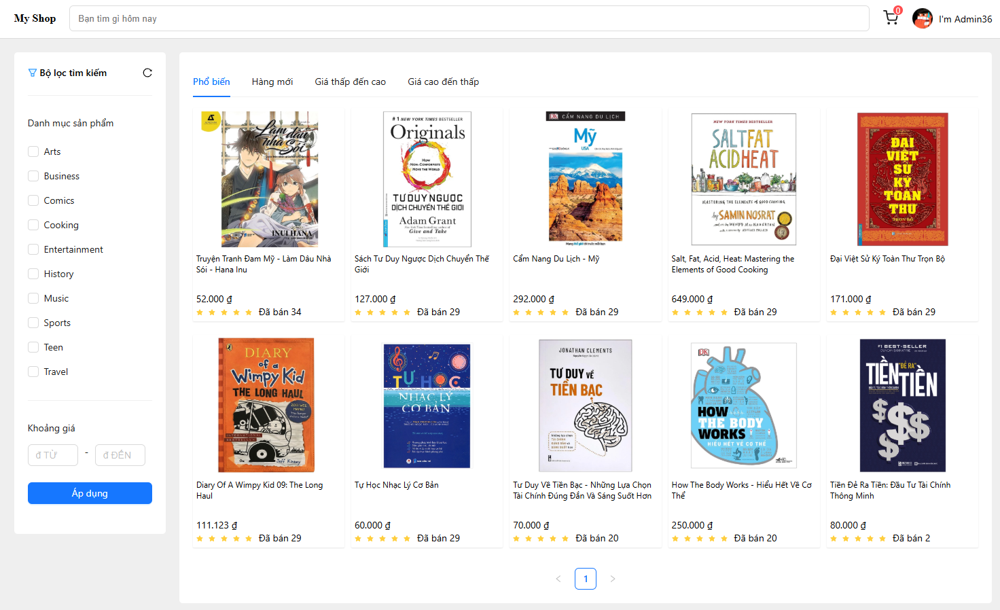
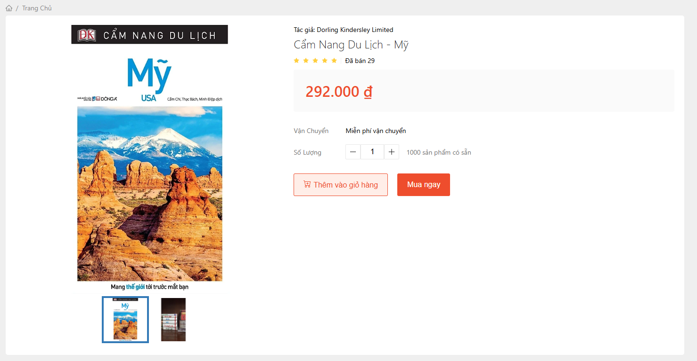
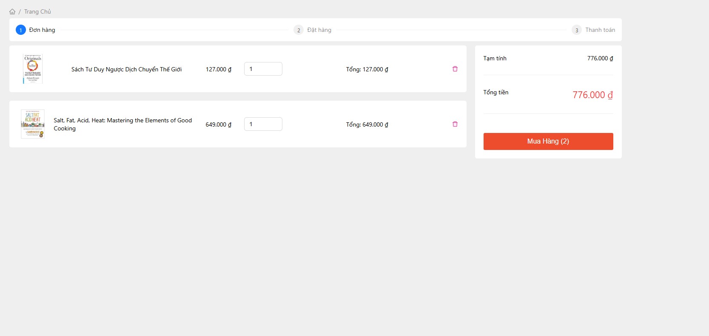
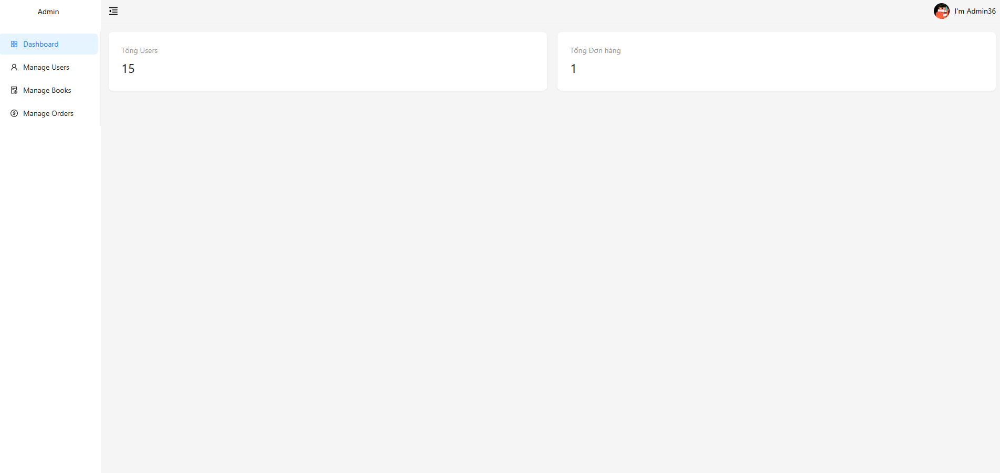
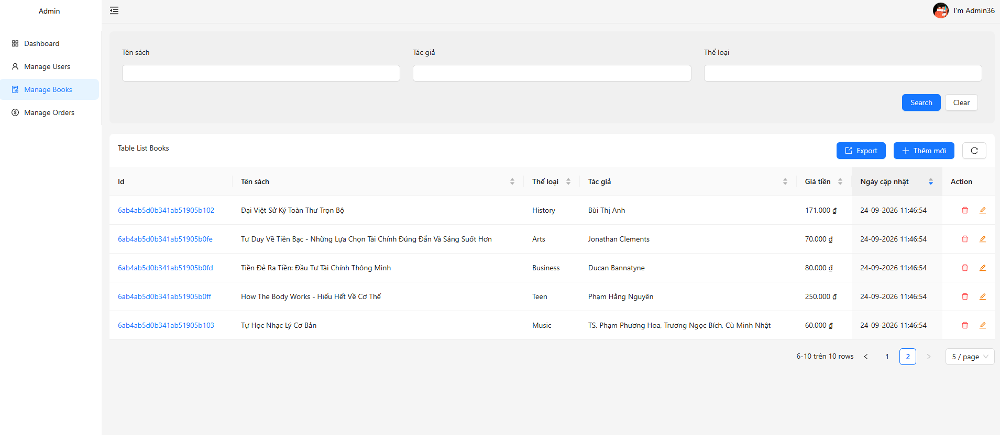

# My Shop - Website bán sách

Ứng dụng web bán sách trực tuyến viết bằng **React**, gồm hai phần: **trang dành cho khách** (xem sách, giỏ hàng, đặt hàng) và **trang quản trị** (quản lý người dùng, sách, đơn hàng).

## Ảnh chụp màn hình

> _Thêm ảnh vào thư mục `docs/` rồi sửa đường dẫn bên dưới._

| Trang chủ                   | Chi tiết sách                | Giỏ hàng                   |
| --------------------------- | ---------------------------- | -------------------------- |
|  |  |  |

| Dashboard admin                        | Quản lý sách                         |
| -------------------------------------- | ------------------------------------ |
|  |  |

## Ứng dụng này dùng để làm gì?

- **Với khách hàng:** duyệt danh sách sách, tìm kiếm, lọc theo thể loại và giá, xem chi tiết, thêm vào giỏ hàng, đặt hàng và xem lại lịch sử mua.
- **Với quản trị viên:** theo dõi số liệu tổng quan, quản lý tài khoản người dùng, quản lý kho sách (kèm ảnh) và xem các đơn hàng đã đặt.

## Chức năng

### Dành cho khách hàng

| Nhóm                 | Chi tiết                                                                                                                                                    |
| -------------------- | ----------------------------------------------------------------------------------------------------------------------------------------------------------- |
| **Tài khoản**        | Đăng ký, đăng nhập, đăng xuất. Giữ đăng nhập sau khi tải lại trang. Quản lý tài khoản: đổi tên, số điện thoại, ảnh đại diện, đổi mật khẩu                   |
| **Trang chủ**        | Danh sách sách có **phân trang**, **sắp xếp** (phổ biến, mới nhất, giá tăng/giảm), **lọc** theo thể loại và khoảng giá, **tìm kiếm** theo tên (có debounce) |
| **Chi tiết sách**    | Xem thông tin, bộ ảnh (gallery), xem ảnh phóng to, chọn số lượng (không vượt quá số sách còn trong kho), skeleton khi đang tải                              |
| **Giỏ hàng**         | Thêm/xóa/sửa số lượng, xem nhanh trên Header, **lưu lại khi tải lại trang**                                                                                 |
| **Đặt hàng**         | Quy trình 3 bước (giỏ hàng, thông tin nhận hàng, hoàn tất), thanh toán khi nhận hàng                                                                        |
| **Lịch sử mua hàng** | Xem lại các đơn đã đặt và chi tiết từng đơn                                                                                                                 |
| **Giao diện**        | Dùng được trên điện thoại: menu dạng ngăn kéo, bộ lọc dạng ngăn kéo                                                                                         |

### Dành cho quản trị viên (`/admin`)

| Nhóm                   | Chi tiết                                                                                                                             |
| ---------------------- | ------------------------------------------------------------------------------------------------------------------------------------ |
| **Dashboard**          | Thống kê tổng số người dùng và tổng số đơn hàng                                                                                      |
| **Quản lý người dùng** | Bảng có phân trang, sắp xếp, tìm kiếm. Thêm, sửa, xóa, xem chi tiết. **Import** danh sách từ file Excel/CSV và **Export** ra Excel   |
| **Quản lý sách**       | Bảng có phân trang, sắp xếp, tìm kiếm. Thêm, sửa, xóa, xem chi tiết. **Upload ảnh** (thumbnail và nhiều ảnh slider). Export ra Excel |
| **Quản lý đơn hàng**   | Xem đơn hàng của toàn bộ khách, có phân trang và sắp xếp                                                                             |

### Bảo mật và phân quyền

- **Route được bảo vệ:** chưa đăng nhập thì bị chuyển về trang đăng nhập; tài khoản thường vào trang admin sẽ thấy trang 403.
- **Phân quyền theo vai trò** (`ADMIN` / `USER`).
- **Tự làm mới token (refresh token):** khi access token hết hạn, ứng dụng tự xin token mới và gửi lại request, người dùng không bị đăng xuất giữa chừng. Có khóa (mutex) để tránh gọi làm mới nhiều lần cùng lúc.

## Công nghệ sử dụng

| Mục đích                               | Công nghệ                                                   | Phiên bản     |
| -------------------------------------- | ----------------------------------------------------------- | ------------- |
| Thư viện giao diện                     | [React](https://react.dev)                                  | 18.2.0        |
| Công cụ build / dev server             | [Vite](https://vitejs.dev) (+ plugin React SWC)             | 4.2.0         |
| Điều hướng                             | [React Router](https://reactrouter.com)                     | 6.9.0         |
| Quản lý state                          | [Redux Toolkit](https://redux-toolkit.js.org) + React Redux | 1.9.3 / 8.0.5 |
| Lưu giỏ hàng khi tải lại trang         | [redux-persist](https://github.com/rt2zz/redux-persist)     | 6.0.0         |
| Thư viện UI                            | [Ant Design](https://ant.design) + Ant Design Icons         | 5.3.2 / 5.0.1 |
| Gọi API                                | [Axios](https://axios-http.com)                             | 1.3.4         |
| Khóa chống gọi trùng khi làm mới token | [async-mutex](https://github.com/DirtyHairy/async-mutex)    | 0.4.0         |
| Đọc/ghi file Excel                     | [SheetJS (xlsx)](https://sheetjs.com)                       | 0.18.5        |
| CSS                                    | [Sass (SCSS)](https://sass-lang.com)                        | 1.59.3        |
| Xử lý ngày giờ                         | [Moment.js](https://momentjs.com)                           | 2.29.4        |
| Gallery ảnh                            | react-image-gallery                                         | 1.2.11        |
| Hiệu ứng số chạy                       | react-countup                                               | 6.x           |
| Biểu tượng                             | react-icons                                                 | 4.8.0         |
| Hiển thị JSON                          | react-json-view                                             | 1.21.x        |
| Vòng quay loading                      | react-spinners                                              | 0.13.8        |
| Sinh mã định danh                      | uuid                                                        | 9.0.0         |

## Một số điểm kỹ thuật

- **Bảng dữ liệu phân trang phía server:** `current`, `pageSize`, `sortQuery`, `filter` là các state nằm trong mảng phụ thuộc của một `useEffect` gọi API, đổi state nào thì dữ liệu tự tải lại.
- **Debounce ô tìm kiếm** để không gọi API ở mỗi phím gõ.
- **Interceptor của Axios:** tự gắn token vào request, xử lý lỗi tập trung, tự làm mới token khi gặp lỗi 401.
- **`redux-persist` với `whitelist`:** chỉ lưu giỏ hàng, không lưu thông tin tài khoản (luôn lấy lại từ server bằng token).
- **Tách component dùng chung:** bộ lọc sách (`BookFilter`) dùng cho cả máy tính và điện thoại; một modal dùng cho cả thêm và sửa sách.
- **Giao diện thích ứng:** CSS media query kết hợp hệ thống lưới của Ant Design.

## Cấu trúc thư mục

```
src/
├── components/
│   ├── Account/          # Quản lý tài khoản (đổi thông tin, mật khẩu)
│   ├── Admin/            # Layout, bảng quản lý User / Book / Order
│   ├── Book/             # Chi tiết sách, gallery ảnh
│   ├── Footer/
│   ├── Header/
│   ├── Home/             # Trang chủ, bộ lọc sách
│   ├── Loading/
│   ├── NotFound/
│   ├── Order/            # Giỏ hàng, thanh toán, lịch sử
│   └── ProtectedRoute/   # Chặn trang theo đăng nhập và vai trò
├── pages/                # Các trang ứng với từng đường dẫn
├── redux/                # Store, slice của account và order
├── services/api.js       # Toàn bộ hàm gọi API
├── styles/               # CSS dùng chung
├── utils/                # axios-customize, hàm tiện ích, hằng số
├── App.jsx               # Khai báo route
└── main.jsx
```

## Các trang

| Đường dẫn             | Mô tả                | Yêu cầu       |
| --------------------- | -------------------- | ------------- |
| `/`                   | Trang chủ            | -             |
| `/book/:slug?id=...`  | Chi tiết sách        | -             |
| `/login`, `/register` | Đăng nhập, đăng ký   | -             |
| `/order`              | Giỏ hàng và đặt hàng | Đăng nhập     |
| `/history`            | Lịch sử mua hàng     | Đăng nhập     |
| `/admin`              | Dashboard            | Vai trò ADMIN |
| `/admin/user`         | Quản lý người dùng   | Vai trò ADMIN |
| `/admin/book`         | Quản lý sách         | Vai trò ADMIN |
| `/admin/order`        | Quản lý đơn hàng     | Vai trò ADMIN |

## Cài đặt và chạy

### Yêu cầu

- **Node.js 18 trở lên, bản 64-bit** (README gốc của khóa học dùng Node 16).
- **Backend API** của khóa học đang chạy (không có trong repo này).

### Các bước

```bash
# 1. Tải mã nguồn
git clone <đường-dẫn-repo-của-bạn>
cd <tên-thư-mục>

# 2. Cài thư viện (cần cờ này vì một số thư viện khai báo peer dependency cũ)
npm i --legacy-peer-deps

# 3. Tạo file .env ở thư mục gốc, trỏ tới backend
#    VITE_BACKEND_URL=http://localhost:8080

# 4. Chạy ở chế độ phát triển
npm run dev
```

Mở trình duyệt tại `http://localhost:3000`.

> Backend cần bật CORS cho địa chỉ `http://localhost:3000` và cho phép gửi cookie (credentials), vì refresh token được lưu trong cookie.

### Build bản production

```bash
npm run build      # tạo thư mục dist/
npm run preview    # chạy thử bản build
```

### Biến môi trường

| Biến               | Ý nghĩa             | Ví dụ                   |
| ------------------ | ------------------- | ----------------------- |
| `VITE_BACKEND_URL` | Địa chỉ backend API | `http://localhost:8080` |
